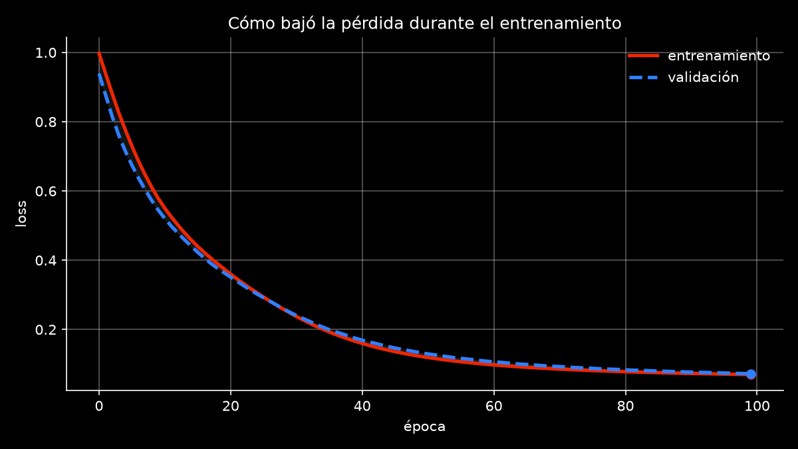

# Pipeline Base con PyTorch

Primer checkpoint del proyecto integrador. Es una red neuronal chica en PyTorch que clasifica flores del dataset Iris, con su ciclo de entrenamiento y de validación.

## Estructura

```
data/           dataset (iris.csv)
src/            código del modelo (train.py)
results/        gráfico de la curva de pérdida (loss_curve.png)
requirements.txt
README.md
```

## Cómo correrlo

Desde la carpeta raíz del proyecto:

```
pip install -r requirements.txt
python src/train.py
```

El script elige solo el dispositivo (GPU, MPS o CPU), entrena el modelo, imprime los resultados cada 10 épocas y guarda el gráfico en `results/loss_curve.png`.

## Lo que hace el código

- **Dataset:** Iris, con 150 flores, 4 medidas por flor y 3 especies. Separé 80% para entrenar y 20% para validar.
- **Modelo:** red con una capa oculta de 32 neuronas con ReLU (`nn.Sequential`: 4 → 32 → 3).
- **Pérdida y optimizador:** CrossEntropyLoss y Adam.
- **Entrenamiento:** 100 épocas, con `zero_grad`, forward, loss, backward y step en cada una.
- **Validación:** en cada época evalúo con los datos de validación (sin calcular gradientes) y guardo la pérdida y el accuracy.
- **Semilla:** 42, para que los resultados se repitan.

## Configuración usada

- **Versión de PyTorch:** 2.15.0 (CPU)
- **Dispositivo:** cpu
- **Learning rate:** 0.01
- **Neuronas en la capa oculta:** 32
- **Épocas:** 100

## Resultados (época 100)

| Métrica | Valor |
|---|---|
| Pérdida de entrenamiento | 0.0698 |
| Pérdida de validación | 0.0723 |
| Accuracy de entrenamiento | 0.983 |
| Accuracy de validación | 1.0 |

El accuracy de validación de 1.0 sale de solo 30 muestras, así que no lo tomo como un resultado perfecto.



## Qué pasó con la curva

La pérdida bajó durante todas las épocas, tanto en entrenamiento como en validación: arrancó cerca de 1.0 y terminó cerca de 0.07. Las dos curvas van casi pegadas, así que no vi señales de sobreajuste. Al llegar a la época 100 todavía bajaban un poco, por lo que con más épocas probablemente mejoraría algo.